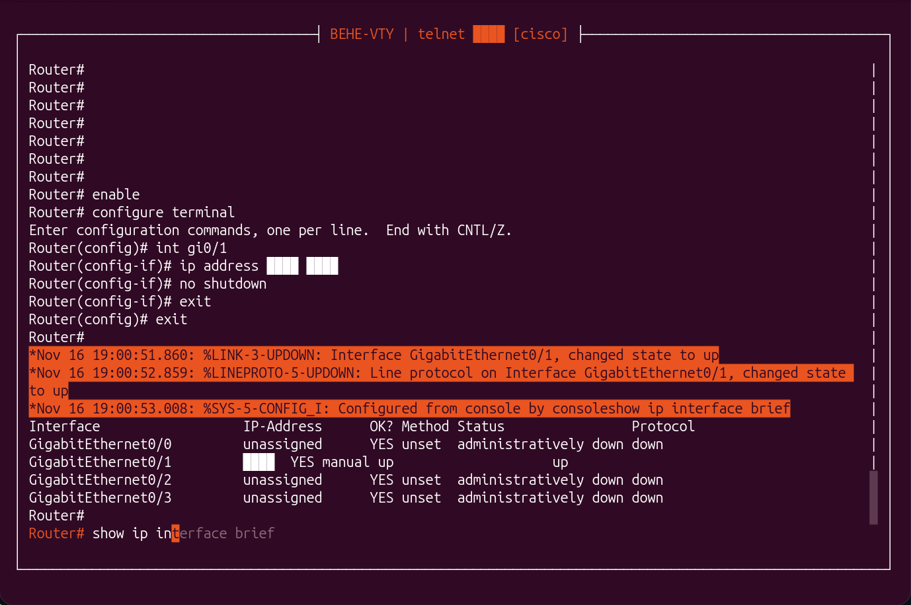
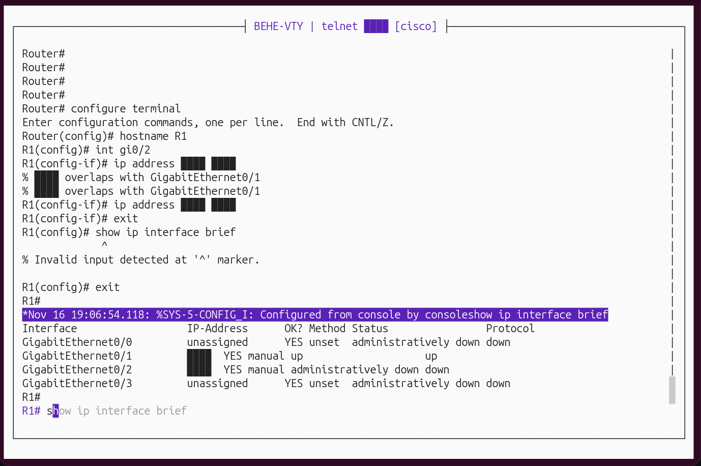

```
██████╗ ███████╗██╗  ██╗███████╗    ██╗   ██╗████████╗██╗   ██╗
██╔══██╗██╔════╝██║  ██║██╔════╝    ██║   ██║╚══██╔══╝╚██╗ ██╔╝
██████╔╝█████╗  ███████║█████╗█████╗██║   ██║   ██║    ╚████╔╝ 
██╔══██╗██╔══╝  ██╔══██║██╔══╝╚════╝╚██╗ ██╔╝   ██║     ╚██╔╝  
██████╔╝███████╗██║  ██║███████╗     ╚████╔╝    ██║      ██║   
╚═════╝ ╚══════╝╚═╝  ╚═╝╚══════╝      ╚═══╝     ╚═╝      ╚═╝  
```

This is a Rust terminal wrapper that provides the typo-free autocomplete into the Cisco / Juniper / Mikrotik consoles. Works with Telnet, SSH or Console cable. 

[](https://github.com/atush-eu/behe-vty/actions/workflows/rust.yml)
[](https://github.com/atush-eu/behe-vty/actions/workflows/rust.yml)
[](https://github.com/atush-eu/behe-vty/actions/workflows/release.yaml)
[](https://github.com/atush-eu/behe-vty/stargazers)
[](https://github.com/atush-eu/behe-vty/releases)
[](LICENSE.md)



## About 

Written in Rush. `%LINK-3-UPDOWN` Cisco / Juniper / Mikrotik commands are listed in the YAML files. Autocomplete will also try to find a match in the comma`%LINK-3-UPDOWN`nd history, on this device or any other device (that user had a sess`%LINK-3-UPDOWN`ion with) from the same vendor. If there is any typo in the command, auto complete will handle it as an `*` regex.

## Features

- SSH, telnet and serial console connections (serial: 8N1, no flow control, 9600 baud default)
- Autocomplete from per-vendor YAML command trees and from command history stored in a local SQLite database — per device, and across devices of the same vendor
- A typo in the input is matched as a `*` wildcard
- Cisco `%LINK-*-CHANGED` messages are filtered and never appear at the input line
- Saved credentials encrypted with AES-256-GCM; the key is derived from a master password with Argon2id
- Five color themes (`themes/`)



## Supported devices

| Vendor | Command tree | Status |
| ------ | ------------ | ------ |
| Cisco IOS | `commands/cisco.yaml` | almost complete |
| Juniper JunOS | `commands/juniper.yaml` | in progress (brief) |
| Mikrotik RouterOS | `commands/mikrotik.yaml` | in progress (brief) |

## Installation

### Releases

Prebuilt binaries for Windows and Linux (glibc and musl): [Releases](https://github.com/atush-eu/behe-vty/releases)

### Install script

```sh
git clone https://github.com/atush-eu/behe-vty.git
cd behe-vty
bash scripts/install.sh          # system-wide into /usr/local/bin
bash scripts/install.sh --user   # into ~/.local/bin
```

Windows:

```powershell
.\scripts\install.ps1
```

### From source

Requires Rust 1.85+ (edition 2024).

```sh
cargo install --git https://github.com/atush-eu/behe-vty --locked
# or
git clone https://github.com/atush-eu/behe-vty.git && cd behe-vty
cargo build --release
```

## Usage

The installer registers three aliases:

```sh
behe-vty
behe-terminal
behe-console
```

In the terminal, connect with:

```
ssh [user@]host[:port]
telnet [user@]host[:port]
console /dev/ttyUSB0 [baud]
diag host[:port]
```

## Configuration

| What | Where |
| ---- | ----- |
| Vendor command trees | `commands/*.yaml` |
| Color themes | `themes/*.toml` |
| SQLite database | override path with `BEHE_VTY_DB` |
| SSH password (non-interactive) | `BEHE_PASSWORD` environment variable |
| Vault master password | `BEHE_VTY_MASTER_PASSWORD` environment variable |

## Development

```sh
cargo build
cargo test
cargo clippy
cargo fmt
```

CI runs on every push and pull request to `main`: the [Rust workflow](.github/workflows/rust.yml) builds and tests, the [Release workflow](.github/workflows/release.yaml) publishes binaries on `v*` tags.

## License

[EUPL-1.2-only](LICENSE.md)

## Security

See [SECURITY.md](SECURITY.md). Report vulnerabilities to security@atush.eu.
